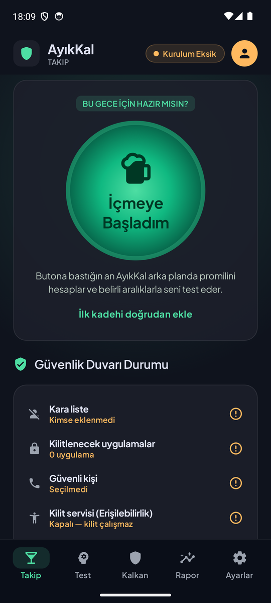
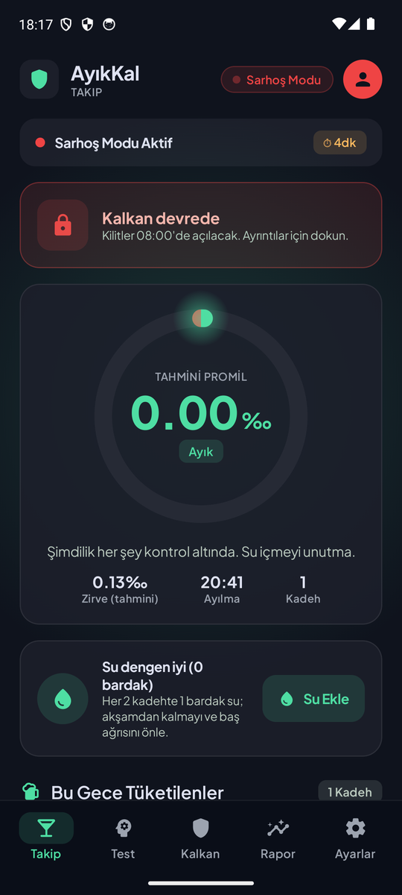
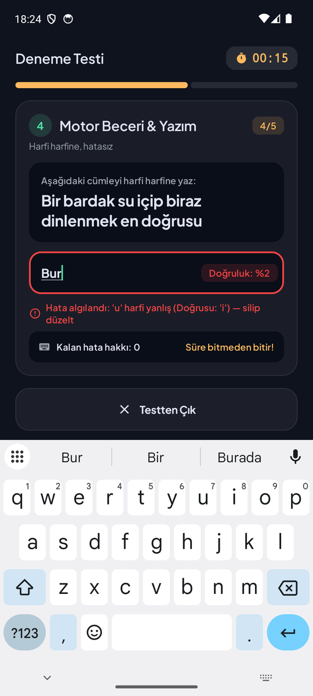
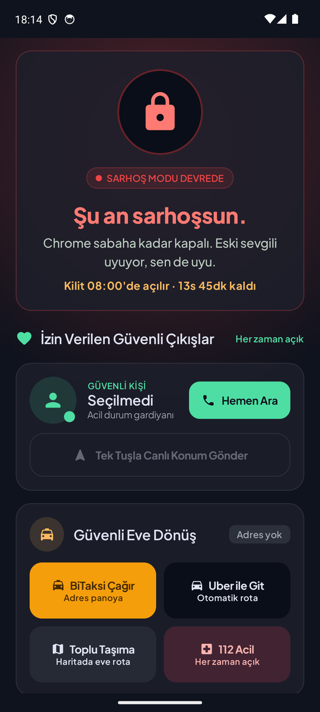
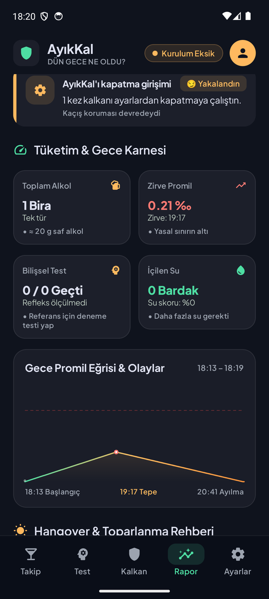
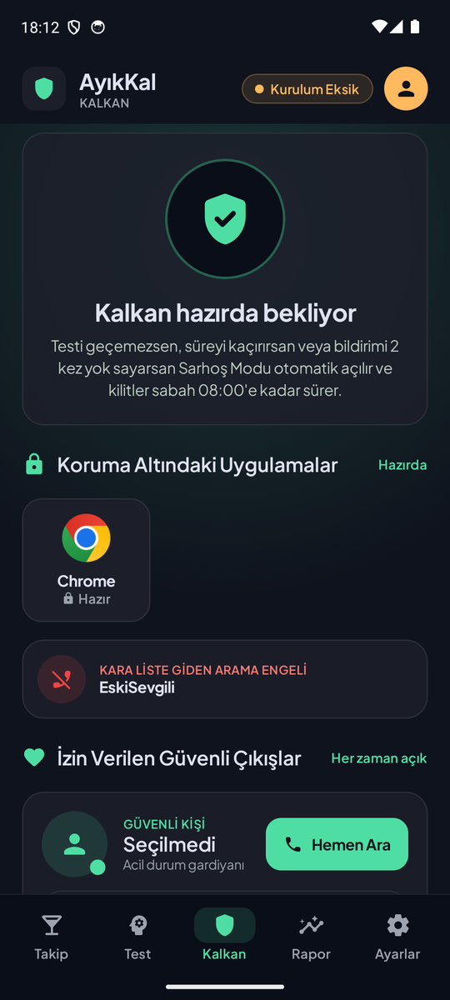

<div align="center">


# AyıkKal

**Sarhoş halin, ayık halinin kararlarını bozamasın.**

Eski sevgiliyi aramak, gece 3'te hikâye atmak, patrona "aslında…" diye başlayan mesajlar.<br/>
AyıkKal içtiklerini takip eder, seni belirli aralıklarla test eder ve testi geçemezsen<br/>
pişman olacağın uygulamaları ve aramaları **sabaha kadar kilitler.**

[](https://github.com/egehan9129/AyikKal/releases/latest)


### [⬇️ APK'yı indir](https://github.com/egehan9129/AyikKal/releases/latest/download/AyikKal.apk)

</div>

---

## Ekranlar

| Takip | Canlı seans | Sarhoşluk testi |
|:---:|:---:|:---:|
|  |  |  |
| **Engel ekranı** | **Sabah raporu** | **Koruma kalkanı** |
|  |  |  |

## Nasıl çalışır?

1. **Ayıkken kur.** Kara listeye kişileri ekle (eski sevgili, patron…), kilitlenecek uygulamaları seç (WhatsApp, Instagram, X, Tinder…), bir güvenli kişi belirle.
2. **İçmeye başla.** Her kadehi ekle; boyuna, kilona, yaşına ve mide durumuna göre promilin canlı tahmin edilir.
3. **Testleri geç.** Belirli aralıklarla telefon alarm gibi çalar: denge, matematik, yazım ve refleks testi. 2 dakika içinde başlamalısın.
4. **Kalkan devreye girer.** Testi geçemezsen, bildirimi iki kez yok sayarsan ya da "pes ettim" dersen **Sarhoş Modu** açılır.
5. **Sabah raporu.** Kilit sabah (ör. 08:00) açılır ve dün gecenin kara kutusu hazırdır.

## Özellikler

**Takip**
- ~40 hazır içki (Efes, Tuborg, Yeni Rakı tek/duble, viski, kokteyller…) ve kendi içkini ekleme
- Widmark + Watson formülüyle kişisel promil tahmini, emilim süresi, tahmini zirve ve ayılma saati
- 0.50‰ yasal sürüş sınırı uyarısı, 2.5‰ üstünde alkol zehirlenmesi uyarısı ve tek tuşla 112
- Her 2 kadehte su hatırlatıcısı

**Sarhoşluk testleri**
- El titremesi ve denge (ivmeölçer), elde gerektiren matematik, harfi harfine yazım (`ğ/g`, `ı/i` ayrımı, otomatik düzeltme ve yapıştırma kapalı), kaçan noktaya dokunma
- Ayıkken yapılan cezasız deneme testiyle **kişisel refleks referansı**; gece normalinden çok yavaşsan test başarısız sayılır
- Promil yükseldikçe testler sıklaşır; her 3. kadehte ek test

**Sarhoş Modu**
- Seçili uygulamalar açıldığı an tam ekran engel: *"Git su iç ve uyu bro, yarın bana teşekkür edeceksin."*
- Kara listedeki numaralara giden aramalar **arama başlamadan kesilir**; onlardan gelen aramalar sessizce reddedilir. 112 asla engellenmez.
- **Kaçış koruması:** AyıkKal'ı ayarlardan kapatmaya veya kaldırmaya çalışırsan ekran kapanır. Sarhoşken ayarlar gevşetilemez.
- Kilit sabah belirlediğin saatte açılır. Erken çıkmanın tek yolu 5 soruluk **Zorlu Ayılma Testi** (Stroop, örüntü, hafıza, zor yazım…); başarısızlık kilidi 1 saat uzatır.
- Her zaman açık güvenli çıkışlar: güvenli kişiyi ara, konumunu SMS ile gönder, BiTaksi / Uber / toplu taşıma ile eve dön.

**Sabah raporu ("Dün Gece Ne Oldu?")**
- Engellenen krizler (hangi uygulamayı kaç kez açmaya çalıştın, kimi aramaktan kurtuldun)
- Toplam alkol, zirve promil, test karnesi, su skoru ve gece boyunca promil eğrisi
- Baş ağrısı risk tahmini ve toparlanma listesi, anonim karne paylaşma, güvenli kişiye "iyiyim" mesajı

## Kurulum

1. [Son sürümden](https://github.com/egehan9129/AyikKal/releases/latest) `AyikKal.apk` dosyasını telefona indir ve aç. Gerekirse "bilinmeyen kaynaklardan yüklemeye" izin ver.
2. Uygulamayı aç; tanıtım ekranlarından sonra kara listeyi, kilitlenecek uygulamaları ve güvenli kişini ayarla.
3. **Sistem İzinleri** ekranından en azından *Erişilebilirlik*, *Bildirimler* ve *Tam zamanlı alarmlar* iznini ver.

> [!IMPORTANT]
> **Erişilebilirlik anahtarı gri ve açılmıyorsa** (Android 13+, Play Store dışından yüklenen uygulamalar):
> *Ayarlar → Uygulamalar → AyıkKal → sağ üst ⋮ → Kısıtlanmış ayarlara izin ver*, sonra tekrar dene.

<details>
<summary><b>Hangi izin ne için?</b></summary>

| İzin | Neden |
|---|---|
| Erişilebilirlik servisi | Kilitli uygulama açıldığı an algılayıp engel ekranını göstermek. Yalnızca hangi uygulamanın önde olduğuna bakar, yazdıklarını okumaz. |
| Bildirimler | Zorunlu test bildirimleri |
| Tam zamanlı alarmlar | Testlerin ve sabah kilit açılışının dakikası dakikasına çalışması |
| Tam ekran bildirim | Ekran kilitliyken test ekranının alarm gibi açılması |
| Arama yönlendirme rolü | Kara listedeki numaraya giden aramayı başlamadan kesmek |
| Arama filtreleme rolü | Kara listedeki kişiden gelen aramayı sessizce reddetmek |
| Pil optimizasyonu muafiyeti | Agresif pil yöneticilerinin alarmları öldürmemesi |
| Doğrudan arama, SMS, konum | Güvenli kişiyi tek dokunuşla arama ve konum gönderme |

</details>

## Gizlilik

- Uygulamanın **internet izni yok**. Kişilerin, içki geçmişin ve olay kayıtların hiçbir zaman telefondan çıkmaz.
- Rehbere toplu erişim istenmez; kişi seçici yalnızca seçtiğin kişiyi uygulamaya verir.

## ⚠️ Sorumluluk reddi

Promil değeri boy, kilo ve içtiklerine dayalı bir **tahmindir**; alkolmetre değildir. **Araç kullanıp kullanmamaya asla bu uygulamaya bakarak karar verme. İçtiysen direksiyona geçme.**
AyıkKal tıbbi bir cihaz değildir. Bilinç bulanıklığı, kusma veya yavaş nefes alkol zehirlenmesi belirtisi olabilir: **112'yi ara.**
Uygulama 18 yaş ve üzeri kullanıcılar içindir.

## Kaynaktan derleme

Gereksinimler: JDK 17 ve Android SDK (platform 35).

```bash
./gradlew :app:assembleDebug        # app/build/outputs/apk/debug/
./gradlew :app:testDebugUnitTest    # birim testleri
```

Release imzası için `~/.gradle/gradle.properties` içine `AYIKKAL_STORE_FILE`, `AYIKKAL_STORE_PASSWORD`, `AYIKKAL_KEY_ALIAS`, `AYIKKAL_KEY_PASSWORD` tanımla. Bu değerler yoksa `assembleRelease` debug anahtarıyla imzalar.

<details>
<summary><b>Proje yapısı</b></summary>

```
app/src/main/java/com/ayikkal/app/
├── data/      Room (içkiler, seanslar, olaylar, kara liste, kilitli uygulamalar), Prefs, Repository
├── domain/    Promil hesabı (Widmark + Watson), test soru üretimi, numara eşleştirme
├── system/    Alarmlar, bildirimler, erişilebilirlik kilidi, arama yönlendirme/filtreleme, güvenli çıkışlar
└── ui/        Compose ekranları: Takip, Test, Kalkan, Rapor, Ayarlar, İzinler, engel ekranı
designs/       Orijinal arayüz tasarımları ve "Nocturnal Clarity" tasarım sistemi
docs/PLAN.md   İlk proje planı ve uygulanırken yapılan değişikliklerin gerekçeleri
```

</details>

Mimari kararların ayrıntısı (neden `SYSTEM_ALERT_WINDOW` yerine erişilebilirlik, neden `CallRedirectionService`, neden WorkManager değil de AlarmManager) için [docs/PLAN.md](docs/PLAN.md) dosyasına bak.
